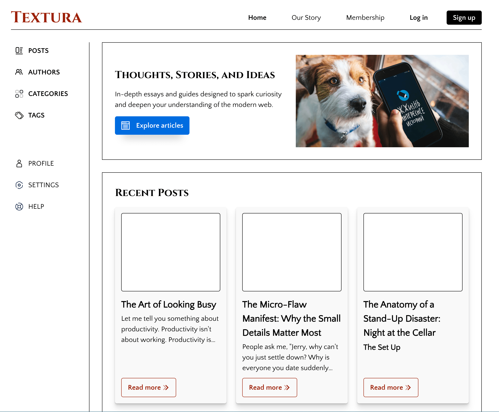
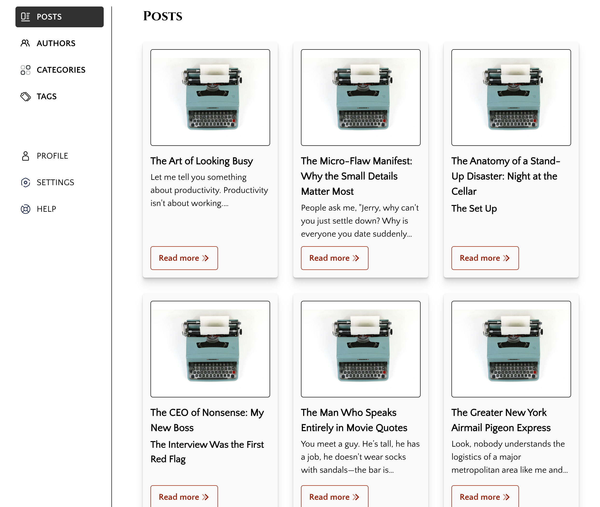
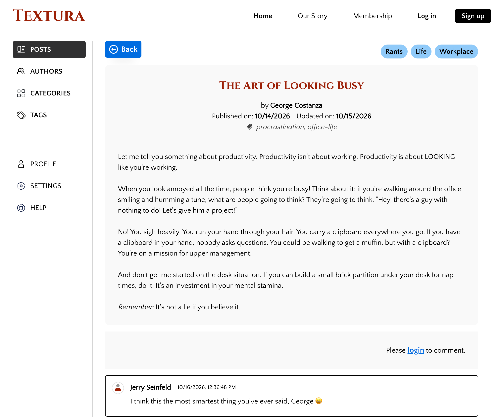
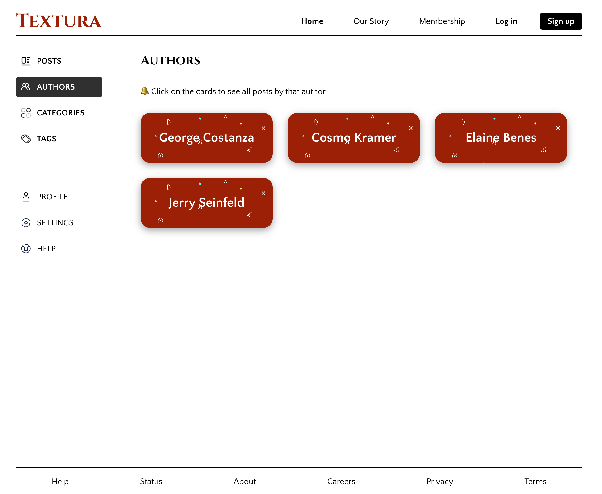
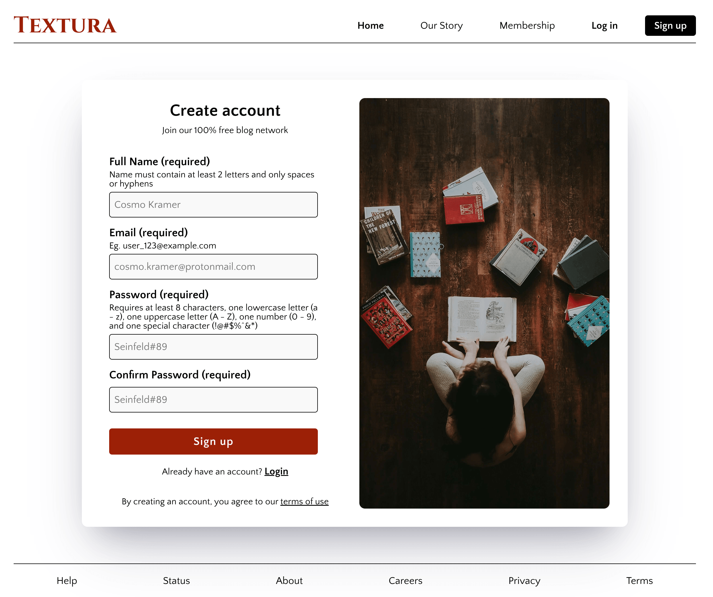
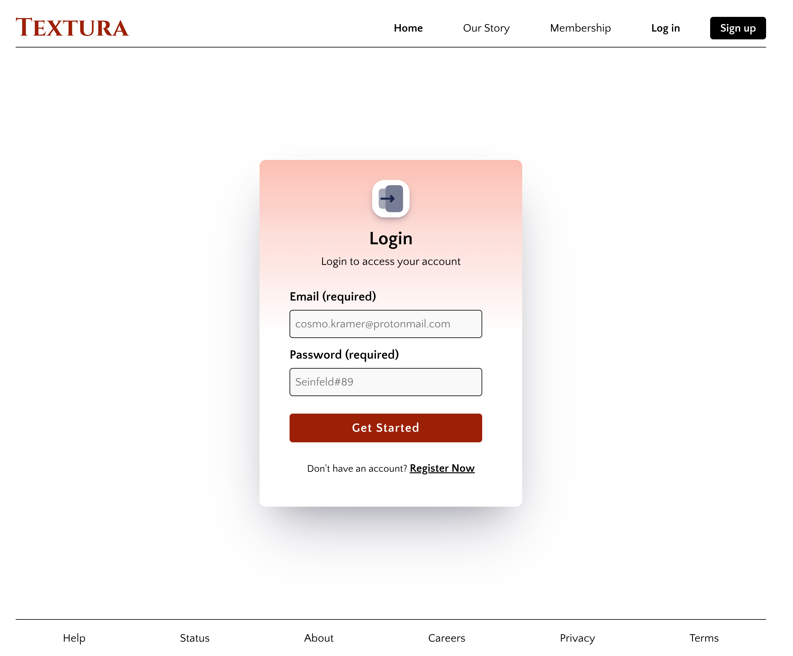

# The Odin Project: Blog API (Reader Client)

This is a solution to the [Blog API Project](https://www.theodinproject.com/lessons/node-path-nodejs-blog-api) as part of The Odin Project curriculum.


## Table of contents


- [The Odin Project: Blog API (Reader Client)](#the-odin-project-blog-api-reader-client)
  - [Table of contents](#table-of-contents)
  - [🎯 Overview](#-overview)
  - [🚀 Key Features](#-key-features)
    - [1. Authentication \& Session Handling:](#1-authentication--session-handling)
    - [2. Article Discovery:](#2-article-discovery)
    - [3. Comments:](#3-comments)
  - [🖼️ Screenshots](#️-screenshots)
  - [🔗 Links](#-links)
  - [🛠️ Tech Stack](#️-tech-stack)
  - [📋 Pre-Requisites](#-pre-requisites)
  - [⚙️ Getting Started](#️-getting-started)
  - [📂 Project Structure](#-project-structure)
  - [Credits](#credits)
    - [Images](#images)
    - [Fonts](#fonts)
    - [Icons](#icons)
    - [Resources](#resources)


## 🎯 Overview


**Reader Client** is a modern React frontend application built for exploring and reading content published on the Author Blog platform. It offers an intuitive interface where users can seamlessly discover articles by posts, authors, categories, and tags. Authenticated users can also engage with the community by leaving comments on articles.


## 🚀 Key Features


### 1. Authentication & Session Handling:

- Secure registration and login interfaces.
- Session management using JSON Web Tokens.
- Restriction of specific routes (e.g., comments) to authenticated users.
- Efficient handling of loading states, error boundaries, and API responses.

### 2. Article Discovery:

- Explore blog posts organized by authors, categories, or tags.
- Browse all articles in a clean, card-based layout featuring post preview.
- Seamlessly read full blog posts with rendered Markdown content.

### 3. Comments:

- Authenticated users can leave comments on any blog post.
- Users can edit or delete their own comments.


## 🖼️ Screenshots


<table>
  <tr>
    <td align="center">
      
      <br>
      <em>Homepage</em>
    </td>
    <td align="center">
      
      <br>
      <em>Posts</em>
    </td>
  </tr>
  <tr>
    <td align="center">
      
      <br>
      <em>Post</em>
    </td>
    <td align="center">
      
      <br>
      <em>Authors</em>
    </td>
  </tr>
  <tr>
    <td align="center">
      
      <br>
      <em>Sign-up</em>
    </td>
    <td align="center">
      
      <br>
      <em>Log-in</em>
    </td>
  </tr>
</table>


## 🔗 Links


- [Solution URL](https://github.com/py-code314/blog-api-reader)
- [Live Page](https://chicken-run-blog-api-reader.netlify.app/home)


## 🛠️ Tech Stack


- **Library:** React
- **Router:** React Router
- **Build Tool:** Vite
- **Styling:** CSS Modules


## 📋 Pre-Requisites


Before you begin, make sure you have the following tools installed on your machine:

- **Node.js** ( [Installation instructions](https://www.theodinproject.com/lessons/foundations-installing-node-js) )
- **npm** ( Installing Node also installs npm alongside it. )
- Running instance of [**Blog API Backend**](https://github.com/py-code314/blog-api-backend)


## ⚙️ Getting Started

1. Run `git clone https://github.com/py-code314/blog-api-reader` to clone the repository.
2. Run `cd blog-api-reader` to navigate to the project directory.
3. Run `npm install` to install dependencies.
4. Create `.env` file and configure the required environment variables based on the `.env.sample` file.
5. Run `npm run dev` to start the development server.


## 📂 Project Structure


```
├── src
│   ├── assets                     # Static assets (images, fonts, icons)
│   │   ├── fonts/                  
│   │   ├── icons/              
│   │   ├── images/                                    
│   ├── components                 # Reusable React components
│   │   ├── core/                  # Core components (e.g., Button)
│   │   ├── features/              # Feature-specific components (e.g., Posts, Categories)
│   │   ├── forms/                 # Form components (e.g., LoginForm, SignupForm)
│   │   ├── layouts/               # Layout components (e.g., Header, Footer)
│   │   ├── sections/              # Section-specific components (e.g., Hero, Comments)
│   ├── contexts/                  # Contexts for global state management (e.g., AuthContext, PostContext)
│   ├── hooks/                     # Custom React hooks (e.g., useFetchData)
│   ├── pages/                     # React components representing individual pages (e.g., Homepage)
│   ├── routes/                    # React Router routes
│   ├── utils/                     # Utility functions (e.g., validateForm)
│   ├── App.jsx                    # Root component
│   ├── App.module.css             
│   ├── index.css                  # Global styles
│   ├── main.jsx                   # Main entry point
├── .env                           # Environment variables
├── .env.sample                    # Template for required environment variables
├── .gitignore
├── eslint.config.js
├── index.html
├── package-lock.json
├── package.json                   # Project dependencies and scripts
├── README.md                      # Project documentation
└── vite.config.js
```


## Credits


### Images

- `books.jpg` - Image **"flat lay photography of woman sitting on brown wooden parquet flooring surrounded   
   by books"** by "Annie Spratt" is from [Unsplash](https://unsplash.com/photos/flat-lay-photography-of-woman-sitting-on-brown-wooden-parquet-flooring-surrounded-by-books-Mmi_sUHNazo)
- `bright-squares.png` - is from [Transparent Textures](https://transparenttextures.com/)
- `error-404.svg` - is from [storyset](https://storyset.com/illustration/404-error/bro)
- `phone-and-dog.jpg` - Image **"a person holding a cell phone next to a dog"** by "Maria Novoseletskaya" is
   from [Unsplash](https://unsplash.com/photos/a-person-holding-a-cell-phone-next-to-a-dog-euxEaczSuc8)
- `typewriter.jpg` - Image **"eal and black typewriter machine"** by "Luca Onniboni" is from [Unsplash](https://unsplash.com/photos/teal-and-black-typewriter-machine-4v9Kk01mEbY)


### Fonts 

- Fonts are downloaded from [Google Fonts](https://fonts.google.com/)

### Icons

- Icons are from [svgrepo](https://www.svgrepo.com/)
- `icon-confetti.svg` is from [SVGBackgrounds.com](https://www.svgbackgrounds.com/set/free-svg-backgrounds-and-patterns/)

### Resources

- Box shadows - [CSS Scan](https://getcssscan.com/css-box-shadow-examples)
- Loading spinner - [CSS Loaders](https://css-loaders.com/spinner/)

